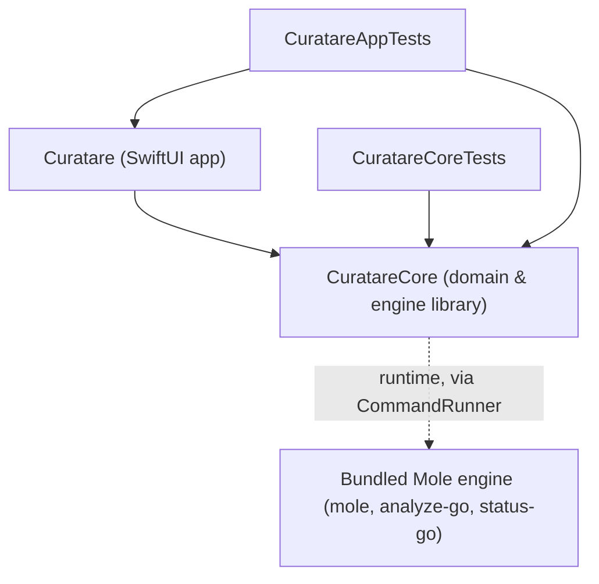

# Code-Graph Wiki — Curatare Symbol & Dependency Index

> **Memory Category:** TencentDB Code-Graph Memory Asset
> **Scope:** Indexed modules, types, key methods, hub nodes, and impact map.
> **Generated from:** `graphify-out/GRAPH_REPORT.md` and `graphify-out/graph.json` (graphifyy 0.9.101, local tree-sitter AST, `--code-only`, no LLM backend, network denied).
> **Built at commit:** `2432dae` on 2026-11-03. Rebuilt at `06923ad` on the same day with identical results (2,437 nodes, 5,533 edges, 65 communities), since only localization strings changed in between.
> **Regenerate:** `GRAPHIFY_NO_TIPS=1 GRAPHIFY_QUERY_LOG_DISABLE=1 GRAPHIFY_BACKEND=off graphify extract . --code-only`, then `GRAPHIFY_BACKEND=off graphify cluster-only . --no-label`, then rewrite this file from the new report. `graphify-out/` is git-ignored and never committed.

---

## 1. Graph Summary

- **Corpus:** 44 code files (Swift, shell, Python) → 2,437 nodes, 5,533 edges, 65 Leiden communities.
- **Edge provenance:** 85% `EXTRACTED`, 15% `INFERRED` (806 edges, average confidence 0.85), 0% `AMBIGUOUS`.
- **Edge relations:** `references` 1,455 · `calls` 1,439 · `case_of` 1,059 · `method` 831 · `implements` 369 · `contains` 231 · `imports` 99.
- **Import cycles:** none.
- **Not indexed:** `Vendor/` (third-party Mole engine), Markdown docs (`--code-only`), `.strings` tables, and build outputs (see `.graphifyignore`).

## 2. Module Dependency Graph

- **`CuratareCore` system frameworks:** `Foundation`, `AppKit`, `CoreServices`, `CryptoKit`, `Darwin`, `IOKit`, `Security`, `Synchronization`, `UniformTypeIdentifiers`, `os`.
- **`Curatare` system frameworks:** `SwiftUI`, `AppKit`, `Foundation`, `Observation`, `UniformTypeIdentifiers`.

## 3. Hub Nodes & Impact Map

| Hub | Edges | Change impact |
| :--- | ---: | :--- |
| `LKey` | 796 | Bridges 18 communities (betweenness 0.579). Adding a case needs `tr`/`en`/`ro` entries; renaming one breaks every view that uses it. |
| `AppModel` | 273 | Bridges 35 communities (betweenness 0.166). The single `@MainActor` state hub for every view; 37 of its edges are `INFERRED`. |
| `AppSettings` | 76 | Persisted preferences (`Keys`), shortcuts, protection whitelist, engine path. |
| `Int64` (extension) | 72 | `saturatingAdding(_:)` and `Sequence.saturatingSum()` in `DiskSpace.swift`; used by every size total. |
| `AppLog` | 54 | File-backed log written by `AppModel` and shown in `LogView`; no other core service calls it. |
| `SystemStatusView` | 49 | Largest view node (38 methods): dashboard, security grid, system center tabs, checksum calculator, and tweak cards, all fed through `AppModel`. |
| `CodingKeys` | 42 | JSON keys of the `status-go` / `analyze-go` payloads in `MoleBridge.swift`. |
| `SystemTweakManager` | 37 | `defaults`-backed tweaks; tests use `MockPreferenceStore`. |
| `LanguageEcosystemItem` | 37 | Dev & AI language ecosystem rows (`ExtendedScanners`). |
| `LocationKind` | 35 | Uninstaller location taxonomy (`AppUninstaller`). |

## 4. Community Map (agent-named)

Graphify leaves communities as `Community N` without an LLM backend; the names below are assigned from member symbols.

| Community | Name | Representative members |
| :--- | :--- | :--- |
| 0 | Localization keys | `LKey` and its 760 cases |
| 1 | System tweaks & preference store | `SystemTweakManager`, `PreferenceStoreProtocol`, `MockPreferenceStore` |
| 2 | Library audit view | `LibraryAuditView`, `AuditGroup` |
| 3 | App state hub | `AppModel`, `AlertItem`, Homebrew and ecosystem filters |
| 4 | Logging | `AppLog`, `LogView` |
| 6 | Uninstaller domain | `AppUninstaller`, `BundleKind`, `AssociatedFile` |
| 7 | App self-update | `AppUpdater`, `UpdateSignature`, `AppUpdateUIState` (`CryptoKit`) |
| 8 | System information center | `SystemCenterCollector`, `DiskSmartStatus` (`IOKit`) |
| 9 | Mole bridge | `MoleBridge`, `MoleDiskAnalysis`, `HiddenSystemUtility` |
| 10 | Extended scanners | `ExtendedScanners`, `HeavyCacheItem`, `AIFootprintItem` |
| 12 | Dated trash | `DatedTrashService`, `DatedTrashError`, `DatedTrashMoveCandidate` |
| 13 | Settings | `AppSettings` properties |
| 14 | Window shell | `ContentView`, `DropZone`, safety banner |
| 16 | Process execution | `CommandRunner`, `ProcessResult`, `HomebrewScanner` |
| 19 | Disk size walks | `DiskSpace`, `ParallelWalk`, `ScanCancellationToken` |
| 20 | Child process guard | `ChildProcessGuard`, `AppDelegate` |
| 21 | Engine locator & updater | `EngineLocator`, `EngineUpdater`, `EngineInfo` |
| 37 | Mole updater script | `Scripts/update-mole.sh` functions |
| 39 | Sandbox | `SandboxProfile` |
| 45 | Protection categories | `ProtectionCategory` cases |

## 5. Core Symbols (`Sources/CuratareCore`)

| File | Types | Key methods |
| :--- | :--- | :--- |
| `Localization.swift` | `AppLanguage`, `StringTable`, `LKey` | `StringTable.load`, `string(_:language:)`; views resolve keys through `AppSettings.L(_:)` / `LF(_:_:)` |
| `CommandRunner.swift` | `ProcessResult`, `EngineError`, `CommandRunner`, `ProcessBox`, `RunState` | `run` |
| `ChildProcessGuard.swift` | `ChildProcessGuard`, `Slot` | `install`, `register`, `unregister`, `terminateAll`, `reapOrphansFromPreviousRun` |
| `Sandbox.swift` | `SandboxProfile` | `readingOnly`, `forMole`, `launchArguments`, `escapeSchemeString`, `sensitiveCredentialFolders` |
| `Engine.swift` | `EngineInfo`, `EngineLocator`, `EngineUpdateResult`, `EngineUpdater` | `locate`, `inspect`, `check`, `install` |
| `ProtectionRules.swift` | `ProtectionCategory`, `ProtectionDecision`, `ProtectionRules`, `RunningProcessSnapshot` | `evaluate`, `isProcessRunning`, `loadUserWhitelist`, `stripKnownSuffixes` |
| `DatedTrash.swift` | `TrashedItemRecord`, `TrashBatchManifest`, `DatedTrashError`, `TrashHistoryFilterKind`, `DatedTrashMoveCandidate`, `DatedTrashService` | `moveToDatedTrash`, `restoreBatch`, `listBatches`, `purgeBatch`, `purgeTrashedItems`, `purgeAllBatches` |
| `LibraryScanner.swift` | `AuditGroup`, `LibraryFinding`, `InstalledBundleIndex`, `LibraryAuditReport`, `LibraryScanner` | `buildInstalledIndex`, `scanAll`, `generateSudoCommand`, `shellQuote` |
| `ExtendedScanners.swift` | `RepoBuildArtifact`, `AIFootprintItem`, `HeavyCacheItem`, `TimeMachineSnapshot`, `LanguageEcosystemItem`, `CacheSubdirectoryInfo`, `ExtendedScanners` | `scanGitHubBuildArtifacts`, `scanAIFootprint`, `scanHeavyCachesAndInstallers`, `scanLanguageEcosystemItems`, `listTimeMachineSnapshots`, `thinTimeMachineSnapshots` |
| `HomebrewScanner.swift` | `HomebrewItem`, `HomebrewStatus`, `HomebrewPackage`, `HomebrewFilterKind`, `HomebrewScanner` | `scan`, `scanPackages`, `cleanupDryRun`, `executeCleanup`, `executeAutoremove`, `uninstallPackages` |
| `AppUninstaller.swift` | `BundleKind`, `AssociatedFile`, `LocationKind`, `InstalledBundle`, `LaunchdManager`, `AppUninstaller`, `SmartBundleMatcher` | `scanInstalledBundles`, `inspectBundle`, `discoverAssociatedFiles`, `uninstallToDatedTrash` |
| `TrashWatcher.swift` | `TrashedAppEvent`, `TrashWatcher` | `start`, `stop`, `checkForNewTrashedApps` |
| `MoleBridge.swift` | `MoleSystemStatus`, `MoleDiskAnalysis`, `MoleDiskEntry`, `MoleAppEntry`, `MoleOptimizationTask`, `MoleOptimizationOutcome`, `SystemSecurityStatus`, `HiddenSystemUtility`, `MoleBridge` | `fetchSystemStatus`, `analyzeDirectory`, `runOptimizationTasks`, `fetchSecurityStatus`, `parseUninstallListJSON` |
| `SystemInfoCenter.swift` | `DiskSmartStatus`, `SystemCenterHardware`, `SystemCenterMemory`, `SystemCenterVolumes`, `SystemCenterOSAndIdentity`, `SystemProfilerProfileKind`, `SystemCenterCollector` | `fetchHardware`, `fetchMemory`, `fetchVolumes`, `fetchOSAndIdentity`, `generateProfile` |
| `SystemTweaks.swift` | `SystemTweakCategory`, `SystemTweakItem`, `SystemChoiceTweak`, `PreferenceStoreProtocol`, `SystemPreferenceStore`, `MockPreferenceStore`, `SystemTweakManager` | `loadAllTweaks`, `applyTweak`, `applyChoiceTweak`, `restoreAllToDefaults`, `safariDevelopMenuShown` |
| `DiskSpace.swift` | `ScanCancellationToken`, `DiskSpace`, `ParallelWalk`; `Int64` and `Sequence` extensions | `size`, `sizes`, `totalSize`, `parseHumanSize`, `formatBytes`, `availableCapacity` |
| `AppUpdate.swift` | `AppRelease`, `AppUpdateResult`, `AppUpdateError`, `UpdateSignature`, `UpdateChecksums`, `AppUpdater` | `check`, `parseRelease`, `isNewer`, `isReleaseURL` |
| `AppLog.swift` | `AppLog` | `info`, `warning`, `error`, `entries`, `clear` |
| `OpenSafety.swift`, `FullDiskAccess.swift`, `FileChecksum.swift`, `AppSoundEffects.swift` | `OpenSafety`, `FullDiskAccess`, `FileChecksumCalculator`, `AppSoundEffects` | `isDeceptive`, `executableKind`, `isGranted`, `computeHashes`, `playTrashSound` |

## 6. App Symbols (`Sources/Curatare`)

| File | Types |
| :--- | :--- |
| `CuratareApp.swift` | `CuratareApp`, `AppDelegate`, `AppCommands`, `MenuBarQuickPanel`, `WindowID` |
| `AppModel.swift` | `AppModel` stored state, `init`, launch work (`windowDidAppear`), permissions, `L` / `LF`, shared helpers |
| `AppModel+<Feature>.swift` | `extension AppModel` per feature: `Operations`, `SmartDelete`, `Updates`, `LibraryAudit`, `Uninstaller`, `DevAI`, `LanguageEcosystems`, `Homebrew`, `BrowserCaches`, `DiskAnalyzer`, `SystemStatus`, `TrashHistory`, `PortableRules` |
| `AppModelTypes.swift` | `StudioSection`, `EngineUpdateUIState`, `AppUpdateUIState`, `PendingTrashConfirmation`, `DevAISubTab`, `DiskAnalyzerSubTab`, `LanguageEcosystemOriginTab`, `AlertItem` |
| `AppIconCache.swift` | `AppIconCache` |
| `AppSettings.swift` | `AppSettings`, `AppInfo`, `AppLinks`, `SystemStatusSubTab`, `SystemCenterTab`, `LicenseDocument`, `AppAppearance`, `KeyboardShortcutData`, `ShortcutAction` |
| `FinderService.swift` | `FinderService` (`uninstallWithCuratare`) |
| `Views/ContentView.swift` | `ContentView`, `WelcomeView`, `DropZone`, `EngineStatusView`, `UpdateBanner`, `ProgressOverlay`, `ToastView` |
| `Views/LibraryAuditView.swift`, `Views/DevAICleanupView.swift`, `Views/BrowserCachesView.swift` | One studio view per file |
| `Views/UninstallerView.swift` (+ `+Sidebar`, `+ListRow`, `+Detail`) | `UninstallerView`, split by panel |
| `Views/HomebrewPackagesView.swift` | `HomebrewStudioView`, `HomebrewPackagesMasterDetailView`, `FlowLayout` |
| `Views/LanguageEcosystemsView.swift` | `LanguageEcosystemsMasterDetailView` |
| `Views/DiskAnalyzerView.swift`, `Views/DuplicateDownloadsView.swift`, `Views/TrashHistoryView.swift` | One view per file |
| `Views/SystemStatusView.swift` (+ `+SystemCenter`, `+Dashboard`, `+Tweaks`, `+Checksum`) | `SystemStatusView`, split by sub-tab |
| `Views/SettingsLogAboutViews.swift` | `SettingsView` (`General`, `Protection`, `Shortcuts`, `Advanced`), `LogView`, `AboutView`, `LicenseViewerSheet` |

## 7. Tests & Scripts

- **`Tests/CuratareCoreTests`:** `LocalizationTests`, `ProtectionRulesTests`, `DatedTrashTests`, `LibraryScannerTests`, `ExtendedAndMoleTests`, `SmartUninstallerTests`, `LaunchdAndDiagnosticsTests`, `DiskSpaceParallelWalkTests`, `HomebrewScannerTests`, `SystemTweaksTests`, `SystemCenterFormattingTests`, `DiskHealthAndScreenshotFormatTests`, `AppSoundEffectsTests`.
- **`Tests/CuratareAppTests`:** `CuratareAppTests`, `TestDefaults`, `MockURLProtocol`.
- **`Scripts/`:** `update-mole.sh` (community 37), `build_app.sh`, `package.sh`, `release.sh`, `verify_bundle.sh`, `set-version.sh`, `make_icon.swift`, `update_signing.swift`, `generate_sounds.py`.

## 8. Known Gaps

- 1,194 isolated nodes, almost all `LKey` cases that the AST pass cannot link to their `L(_:)` / `LF(_:_:)` call sites (`AppSettings`, `AppModel`).
- `INFERRED` edges (15%) are name-based guesses; confirm with `graphify explain "<symbol>"` before relying on them for impact analysis.
