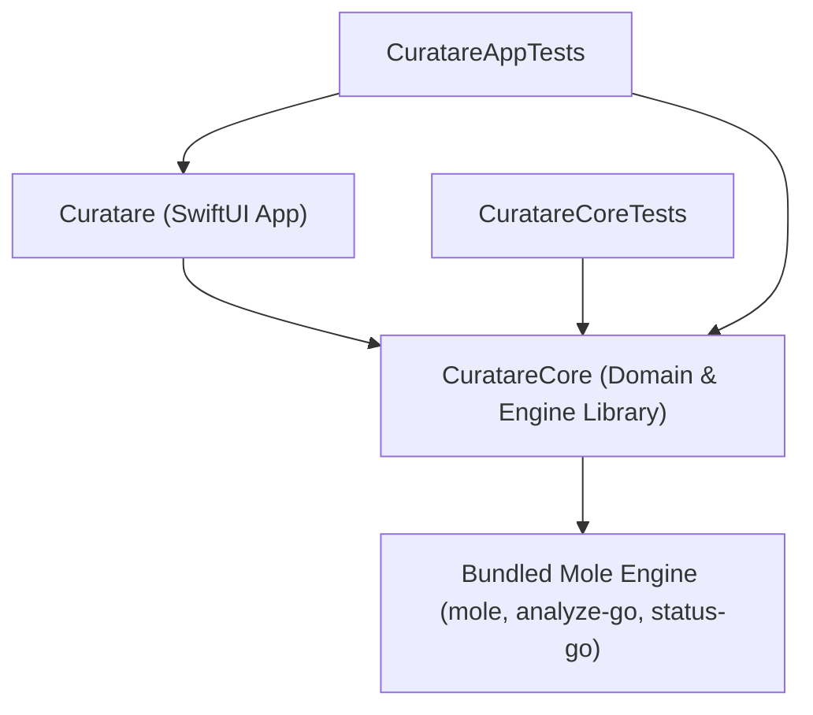

# Code-Graph Wiki — Curatare Symbol & Dependency Index

> **Memory Category:** TencentDB Code-Graph Memory Asset
> **Scope:** Indexed modules, public types, call hierarchy, and impact map.

---

## 1. Module Dependency Graph

## 2. Core Symbols (`Sources/CuratareCore`)

- **`Localization.swift`**: `AppLanguage`, `LKey`, `StringTable`, `L(_:language:)`
- **`CommandRunner.swift` & `ChildProcessGuard.swift`**: `CommandRunner`, `CommandResult`, `ChildProcessGuard`
- **`Sandbox.swift`**: `SandboxProfile` (`forReadOnlyScan`, `forDatedTrashMove`, `forMoleHelper`, `escapeSchemeString`)
- **`Engine.swift`**: `EngineSource`, `EngineInfo`, `EngineLocator`, `EngineUpdateStatus`, `EngineUpdateResult`, `EngineUpdater`
- **`ProtectionRules.swift`**: `ProtectionCategory`, `ProtectionDecision`, `ProtectionRules` (`evaluate`, `stripKnownSuffixes`, `isProcessRunning`, `RunningProcessSnapshot`)
- **`DatedTrash.swift`**: `TrashedItemRecord`, `TrashBatchManifest`, `DatedTrashService` (`createBatch`, `moveItemsToDatedTrash`, `restoreBatch`, `listBatches`)
- **`LibraryScanner.swift`**: `AuditGroup` (`groupA`..`groupE`), `LibraryFinding`, `LibraryAuditReport`, `InstalledBundleIndex`, `LibraryScanner` (`buildInstalledIndex`, `scanAll`, `generateSudoCommand`)
- **`ExtendedScanners.swift`**: `RepoBuildArtifact`, `AIFootprintItem`, `HeavyCacheItem`, `TimeMachineSnapshot`, `ExtendedScanners`
- **`AppUninstaller.swift`**: `BundleKind` (`application`, `widget`, `plugin`), `AssociatedFile`, `InstalledBundle`, `AppUninstaller` (`scanInstalledBundles`, `discoverAssociatedFiles`, `uninstallToDatedTrash`)
- **`TrashWatcher.swift`**: `TrashedAppEvent`, `TrashWatcher` (SmartDelete `~/.Trash` FSEvents/DispatchSource monitor)
- **`MoleBridge.swift`**: `MoleSystemStatus`, `MoleDiskAnalysis`, `MoleDiskEntry`, `MoleAppEntry`, `MoleOptimizationItem`, `MoleBridge`
- **`AppLog.swift`, `AppUpdate.swift`, `OpenSafety.swift`, `DiskSpace.swift`**: `AppLog`, `AppRelease`, `AppUpdateResult`, `AppUpdater`, `UpdateSignature`, `UpdateChecksums`, `OpenSafety`, `DiskSpace` (`spotlightSize`, `size`, `totalSize`, `parseHumanSize`, `formatBytes`), `ScanCancellationToken`

## 3. App Symbols (`Sources/Curatare`)

- **`CuratareApp.swift`**: `CuratareApp`, `AppDelegate`, `WindowID`, `AppCommands`
- **`AppSettings.swift`**: `AppInfo`, `AppLinks`, `LicenseDocument`, `AppAppearance`, `KeyboardShortcutData`, `ShortcutAction`, `AppSettings`
- **`AppModel.swift`**: `AppModel`, `StudioSection` (`home`, `libraryAudit`, `uninstaller`, `devAndAI`, `browserAndCaches`, `diskAnalyzer`, `systemStatus`, `trashHistory`), `EngineUpdateUIState`
- **`FinderService.swift`**: `FinderService` (`uninstallWithCuratare`)
- **`Views/`**: `ContentView`, `WelcomeView`, `LibraryAuditView`, `UninstallerView`, `DevAICleanupView`, `BrowserCachesView`, `DiskAnalyzerView`, `SystemStatusView`, `TrashHistoryView`, `SettingsView`, `LogView`, `AboutView`
