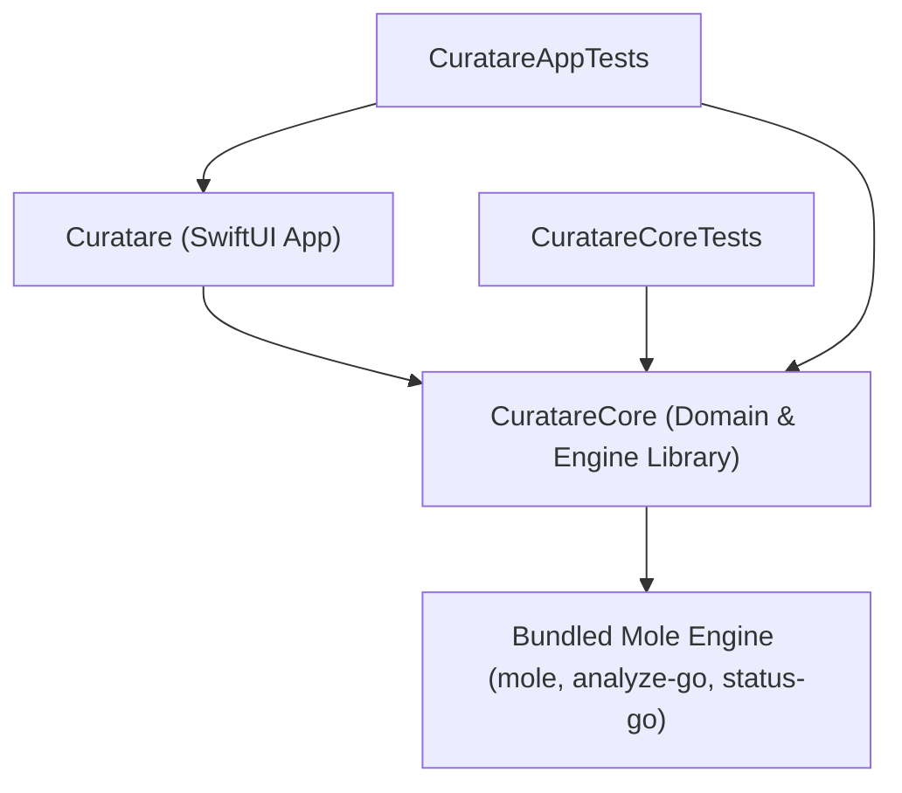

# Code-Graph Wiki — Curatare Symbol & Dependency Index

> **Memory Category:** TencentDB Code-Graph Memory Asset
> **Scope:** Indexed modules, public types, call hierarchy, and impact map.
> **Source:** Hand-synced with `Sources/` on 2026-11-03.
>   - `graphify` is not installed yet and `graphify-out/` does not exist.
>   - Regenerate this file from `graphify-out/GRAPH_REPORT.md` once a Graphify build exists (`.agents/rules/graphify_knowledge_graph.md`).

---

## 1. Module Dependency Graph

## 2. Core Symbols (`Sources/CuratareCore`)

- **`Localization.swift`**:
  - `AppLanguage`.
  - `LKey`: every user-facing string key.
  - `StringTable`: `string(_:language:)`. It reads the `tr`/`en`/`ro` `Localizable.strings` files.
- **`CommandRunner.swift` & `ChildProcessGuard.swift`**: `CommandRunner` (`run(_:timeout:)`), `ProcessResult` (`exitCode`, `stdout`, `stderr`), `EngineError`, `ChildProcessGuard`.
- **`Sandbox.swift`**: `SandboxProfile` (`readingOnly(scratchDirectory:)`, `forMole(writableDirectories:)`, `escapeSchemeString`).
- **`Engine.swift`**: `EngineInfo`, `EngineLocator` (`locate`, `locateScript`), `EngineUpdateResult`, `EngineUpdater` (`check`, `install`).
- **`ProtectionRules.swift`**: `ProtectionCategory`, `ProtectionDecision`, `ProtectionRules` (`evaluate(path:candidateIdentifier:)`, `stripKnownSuffixes`, `isProcessRunning`, `loadUserWhitelist`, `RunningProcessSnapshot`).
- **`DatedTrash.swift`**: `TrashedItemRecord`, `TrashBatchManifest`, `DatedTrashError`, `DatedTrashMoveCandidate`, `TrashHistoryFilterKind`, `DatedTrashService` (`moveToDatedTrash(candidates:title:...)`, `restoreBatch`, `listBatches`, `purgeBatch`, `purgeTrashedItem(s)`, `purgeAllBatches`).
- **`LibraryScanner.swift`**: `AuditGroup` (`groupA`..`groupE`), `LibraryFinding`, `LibraryAuditReport`, `InstalledBundleIndex`, `LibraryScanner` (`buildInstalledIndex`, `scanAll`, `generateSudoCommand`).
- **`ExtendedScanners.swift`**:
  - Item types: `RepoBuildArtifact`, `AIFootprintItem`, `HeavyCacheItem`, `TimeMachineSnapshot`, `LanguageEcosystemItem`, `CacheSubdirectoryInfo`.
  - `ExtendedScanners` methods: `scanGitHubBuildArtifacts`, `scanAIFootprint`, `scanHeavyCachesAndInstallers`, `scanLanguageEcosystemItems`, `listTimeMachineSnapshots`, `thinTimeMachineSnapshots`.
- **`HomebrewScanner.swift`**: `HomebrewItem`, `HomebrewStatus`, `HomebrewPackage`, `HomebrewFilterKind`, `HomebrewScanner` (`scan`, `scanPackages`, `uninstallPackage(s)`, `executeCleanup`, `executeAutoremove`, `executeServicesCleanup`).
- **`AppUninstaller.swift`**:
  - `BundleKind` (`application`, `widget`, `plugin`).
  - `AssociatedFile`, with `LocationKind.titleKey` mapped to the `uninstallerKind*` `LKey`s.
  - `InstalledBundle`, `LaunchdManager`.
  - `AppUninstaller` (`scanInstalledBundles`, `inspectBundle`, `discoverAssociatedFiles`, `uninstallToDatedTrash`).
- **`TrashWatcher.swift`**: `TrashedAppEvent`, `TrashWatcher` (SmartDelete `~/.Trash` monitor: `start`, `stop`, `checkForNewTrashedApps`).
- **`MoleBridge.swift`**:
  - Status and analysis types: `MoleSystemStatus`, `MoleDiskAnalysis`, `MoleDiskEntry`, `MoleAppEntry`.
  - `MoleOptimizationTask`: `ActionKind` (12 cases) with `titleKey`, and `defaultTasks`.
  - `MoleOptimizationOutcome`:
    - `Status`: `done`, `failed`, `needsAdmin(command:)`.
    - `dnsFlushCommand`.
    - `apfsVerify(_:)`.
  - `MoleBridge`:
    - Status and analysis: `fetchSystemStatus`, `analyzeDirectory`, `fetchSecurityStatus`, `purgeInactiveMemory`.
    - Maintenance: `runOptimizationTasks`, `staleSavedStates(in:olderThan:...)`, `savedStateMaxAge`.
  - `SystemSecurityStatus`, `HiddenSystemUtility` (`defaultUtilities`).
- **`SystemTweaks.swift`**:
  - Tweak models: `SystemTweakCategory`, `SystemTweakItem` (`enabledValue`, `RestartService`), `SystemChoiceTweak` (`Option.systemDefault`/`on`/`off`/`count(_:)`/`milliseconds(_:)`).
  - Preference values and stores:
    - `PreferenceValue` (`matches(_:)`).
    - `PreferenceStoreProtocol` (`readBool`/`writeBool`, `readString`/`writeString`, `readValue`/`writeValue`, `removeValue`, `restartService`).
    - `SystemPreferenceStore` (`preferencesDomain(for:)` maps `NSGlobalDomain` to `kCFPreferencesAnyApplication`).
    - `MockPreferenceStore`.
  - Screenshot and Safari settings: `ScreenshotFormat`, `ScreenshotNamePrefix` (`sanitized`), `ScreenshotLocation`, `SafariDevelopMenu` (read-only).
  - `SystemTweakManager`:
    - Data: `definitions`, `choiceDefinitions`.
    - Toggles and choices: `loadAllTweaks`, `applyTweak`, `loadChoiceTweaks`, `applyChoiceTweak`, `restoreAllToDefaults`.
    - Screenshot settings: `screenshotFormat`/`setScreenshotFormat`, `screenshotNamePrefix`/`setScreenshotNamePrefix`, `screenshotLocation`/`setScreenshotLocation`.
    - Other: `safariDevelopMenuShown`, `addDockSpacer`, `removeDockSpacers`.
- **`SystemInfoCenter.swift`**:
  - Snapshot types: `SystemCenterHardware`, `SystemCenterMemory`, `SystemCenterVolumes` (`SystemCenterVolumeItem`, `SystemCenterVolumeKind`), `SystemCenterOSAndIdentity`, `DiskSmartStatus`.
  - Profile types: `SystemProfilerProfileKind`, `SystemProfilerFormat`.
  - `SystemCenterCollector`: `fetchHardware`, `fetchMemory`, `fetchVolumes`, `fetchOSAndIdentity`, `generateProfile`.
- **`FileChecksum.swift`**: `FileChecksumResult` (`md5`, `sha1`, `sha256`, `verify(expected:)`), `FileChecksumCalculator` (`computeHashes(for:)`).
- **`FullDiskAccess.swift`**: `FullDiskAccess` (`openSystemSettings`).
- **Other files:**
  - `AppLog.swift`: `AppLog`.
  - `AppSoundEffects.swift`: `AppSoundEffects`.
  - `AppUpdate.swift`: `AppRelease`, `AppUpdateResult`, `AppUpdateError`, `AppUpdater`, `UpdateSignature`, `UpdateChecksums`.
  - `OpenSafety.swift`: `OpenSafety`.
  - `DiskSpace.swift`: `DiskSpace` (`size`, `sizes(of:)`, `totalSize`, `parseHumanSize`, `formatBytes`, `saturatingSum`), `ParallelWalk`, `ScanCancellationToken`.

## 3. App Symbols (`Sources/Curatare`)

- **`CuratareApp.swift`**: `CuratareApp`, `AppDelegate`, `WindowID`, `AppCommands`.
- **`AppSettings.swift`**: `AppInfo`, `AppLinks`, `FamilyApp(s)`, `SystemStatusSubTab`, `SystemCenterTab`, `LicenseDocument`, `UninstallerStartupView`, `AppAppearance`, `KeyboardShortcutData`, `ShortcutAction`, `AppSettings`.
- **`AppModel.swift`**:
  - `AppModel` (`L(_:)`, `LF(_:_:)`).
  - Tweak and maintenance actions: `applySystemTweak`, `applyChoiceTweak`, `setScreenshotFormat`, `setScreenshotNamePrefix`, `setScreenshotLocation`, `refreshSafariDevelopMenuState`, `openSafari`, `runSelectedOptimizations`, `reportOptimizationOutcomes`.
  - `StudioSection`: `home`, `libraryAudit`, `uninstaller`, `homebrew`, `devAndAI`, `browserAndCaches`, `diskAnalyzer`, `systemStatus`, `trashHistory`.
  - Other types: `EngineUpdateUIState`, `AppUpdateUIState`, `PendingTrashConfirmation`, `DevAISubTab`, `LanguageEcosystemOriginTab`, `AlertItem`, `AppIconCache`.
- **`FinderService.swift`**: `FinderService` (`uninstallWithCuratare`).
- **`Views/`**:
  - `ContentView.swift`: `ContentView`, `WelcomeView`, `ProgressOverlay`, `InlineLoadingBar`, `LoadOnFirstVisit`, `ToastView`.
  - `StudioSectionsView.swift`: `LibraryAuditView`, `UninstallerView`, `DevAICleanupView`, `BrowserCachesView`.
  - `SystemAndHistoryViews.swift`:
    - Views: `DiskAnalyzerView`, `SystemStatusView`, `TrashHistoryView`.
    - Tweak cards in `SystemStatusView`: `tweakCard`, `choiceTweakCard`, `screenshotFormatCard`, `screenshotNameCard`, `screenshotLocationCard`, `safariDevelopMenuCard`.
  - `HomebrewPackagesView.swift`: `HomebrewStudioView`, `HomebrewPackagesMasterDetailView`.
  - `LanguageEcosystemsView.swift`: `LanguageEcosystemsMasterDetailView`.
  - `SettingsLogAboutViews.swift`: `SettingsView` (general, protection, shortcuts and advanced panes), `LogView`, `AboutView`, `LicenseViewerSheet`.
  - Other views: `MenuBarQuickPanel`, `DropZone`, `EngineStatusView`, `UpdateBanner`.

## 4. Impact Map (where a change ripples)

- **A new user-facing string** → `LKey` + all three `Localizable.strings` in identical key order (the parity test checks every key and format specifier).
- **A new tweak:**
  - Add it to `SystemTweakManager.definitions` or `choiceDefinitions`.
  - Add its `LKey` title and description.
  - Update the tweak counts in `CuratareCoreTests` and `CuratareAppTests`.
  - Check that **Reset All** restores it.
- **A new maintenance task:**
  - Add the `MoleOptimizationTask.ActionKind` case, its `titleKey` and its `defaultTasks` entry.
  - Return an honest `MoleOptimizationOutcome` from `runOptimizationTasks`.
  - Update the task count in the app test.
- **A preference write through CFPreferences** → map defaults aliases (`NSGlobalDomain`) and verify once against `defaults read`. For a sandboxed app's domain, prove both directions live, or keep it read-only.
