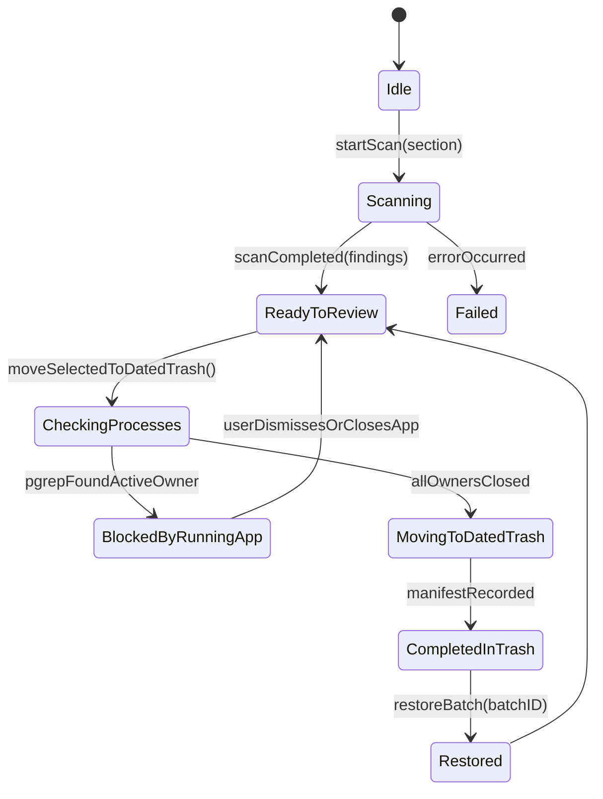

# Symbolic Short-Term Memory Topo-Graph — Curatare

> **Memory Category:** TencentDB Symbolic Graph Asset
> **Scope:** Runtime state transitions for scans, dated-trash batches, and batch restoration.

---

